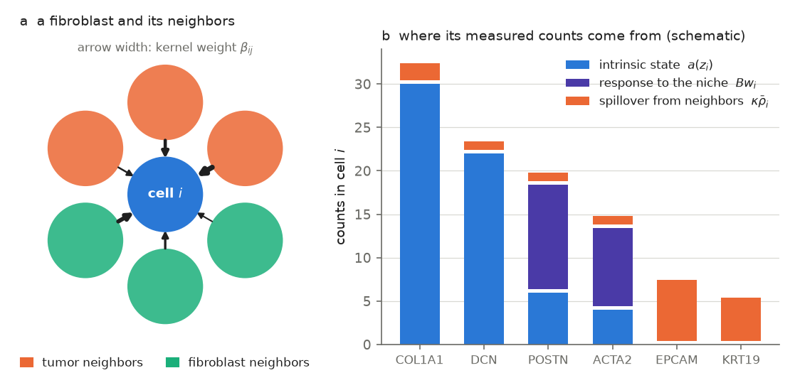
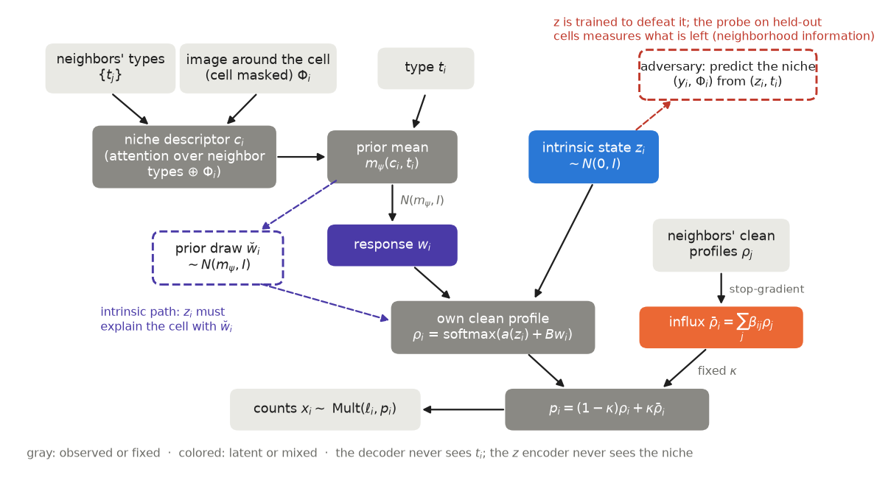
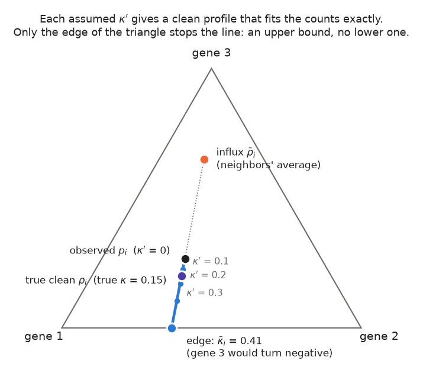
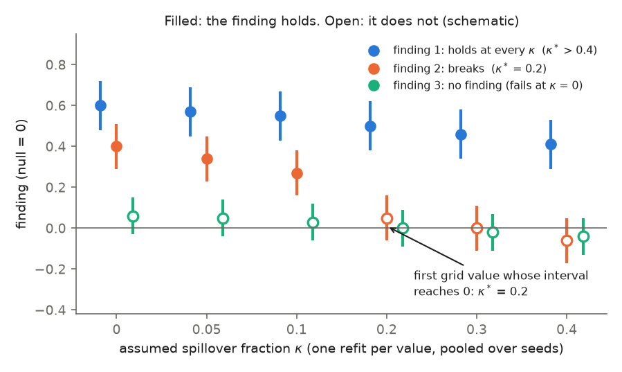
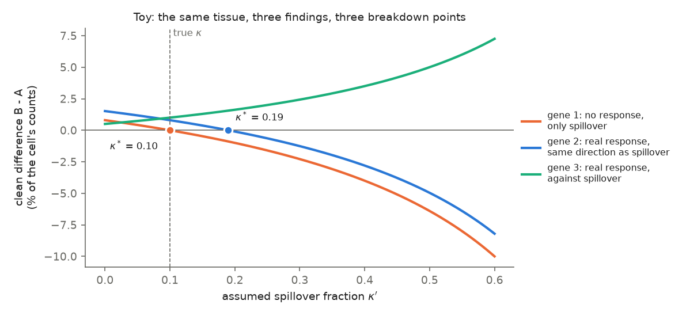
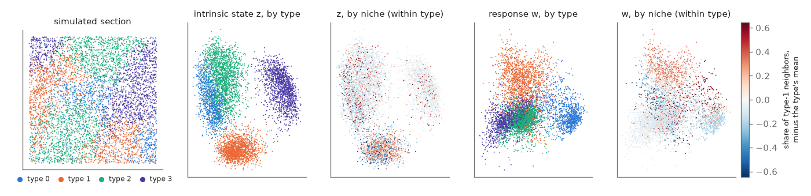
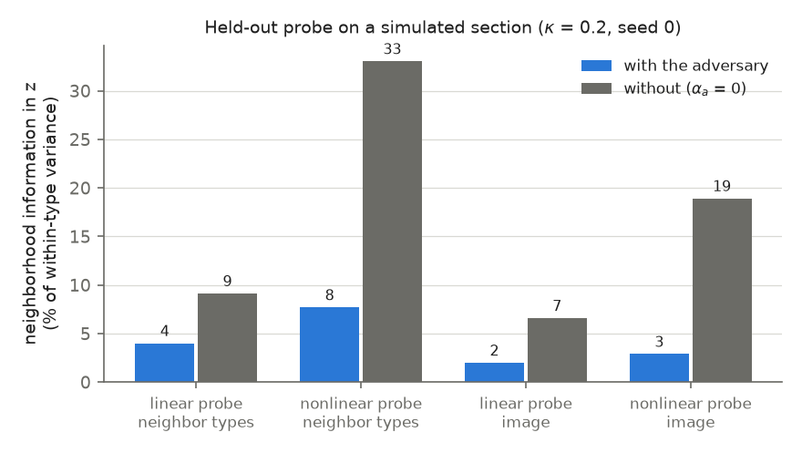
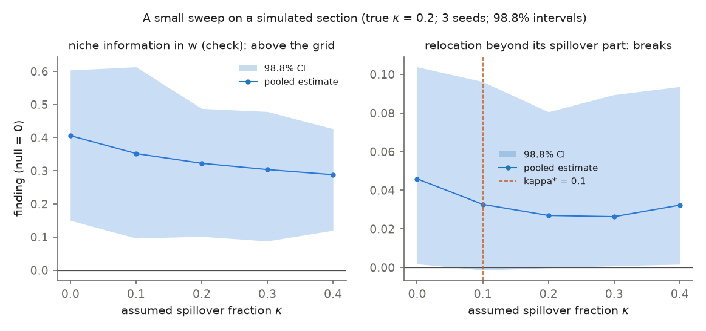

# The DisCell model

This page explains what DisCell assumes about a segmented cell's counts, how it is fitted, and
what it can and cannot learn from the data. It follows the paper's model section, in plainer
terms. [code.md](code.md) maps each equation to the function that computes it.

Contents

1. [The problem](#1-the-problem)
2. [The generative model](#2-the-generative-model)
3. [The cell graph and the spillover kernel](#3-the-cell-graph-and-the-spillover-kernel)
4. [The niche descriptor](#4-the-niche-descriptor)
5. [Fitting the model](#5-fitting-the-model)
6. [Keeping the niche out of z: the adversary and the probe](#6-keeping-the-niche-out-of-z-the-adversary-and-the-probe)
7. [What the counts can tell about κ: an upper bound](#7-what-the-counts-can-tell-about-κ-an-upper-bound)
8. [The sweep and breakdown points](#8-the-sweep-and-breakdown-points)
9. [What else is not identified](#9-what-else-is-not-identified)
10. [Relocation](#10-relocation)
11. [The per-gene split](#11-the-per-gene-split)
12. [A check on simulated data](#12-a-check-on-simulated-data)

## 1. The problem

In imaging spatial transcriptomics (Xenium, MERSCOPE, CosMx), each transcript is detected at a
position, and segmentation assigns it to a cell. The counts of one segmented cell then come
from three sources.

* **The intrinsic state.** The cell's own properties, which it would keep in any niche: its
  type, its cell-cycle phase and anything else that does not depend on its surroundings. In
  DisCell this is the latent vector $z_i$.
* **The response to the niche.** How the cell has changed because of where it sits, for
  example a fibroblast that turns on a matrix program next to a tumor. This is the latent
  vector $w_i$.
* **Spillover.** Transcripts that belong to neighboring cells but were assigned to this one,
  because boundaries are drawn imperfectly and transcripts diffuse. DisCell models the share
  of a cell's counts that comes from its neighbors as the **spillover fraction κ**.



*The three sources of one cell's counts (schematic). Panel b uses made-up numbers.*

The difficulty is that two of these sources leave the same mark. A response to tumor neighbors
and spillover from tumor neighbors both make a fibroblast's expression track how many tumor
cells surround it. Ignore spillover and you over-count responses. Remove "spillover" with a
fixed correction and you may erase real responses. A third confound comes from tissue
structure: cell types cluster in space, so a cell's type and its niche are correlated, and a
model can mistake one for the other.

DisCell separates the three in one model, keeps the niche out of the intrinsic state by
training, measures how well that worked, and reports how much spillover each finding can
tolerate.

## 2. The generative model

For each cell $i$ we observe its counts $x_i$ over $G$ genes (with total $\ell_i$), its type
label $t_i$, its position, and optionally the morphology image around it. The model is

```math
\begin{aligned}
z_i &\sim \mathcal N(0, I) \\
w_i \mid c_i, t_i &\sim \mathcal N\big(m_\psi(c_i, t_i),\ I\big) \\
\rho_i &= \operatorname{softmax}\big(a(z_i) + B\,w_i\big) \\
\bar\rho_i &= \textstyle\sum_{j \in N(i)} \beta_{ij}\,\rho_j \\
p_i &= (1-\kappa)\,\rho_i + \kappa\,\bar\rho_i \\
x_i \mid \ell_i &\sim \operatorname{Multinomial}(\ell_i,\ p_i)
\end{aligned}
```

In words:

* $\rho_i$ is the cell's own **clean profile**: the share of each gene among its own
  transcripts. It is built from two parts that add on the log scale. The intrinsic part
  $a(z_i)$ is a neural network of the intrinsic state. The response part $B\,w_i$ is linear in
  the response.
* Column $k$ of the loadings $B$ is a gene program, and $w_{ik}$ says how far cell $i$ has
  moved along it.
* The prior mean $m_\psi(c_i, t_i)$ is the response expected of a cell of type $t_i$ in a
  niche described by $c_i$ (section 4). The prior scale is fixed at 1, which pins the scale of
  $w$ against that of $B$.
* $\bar\rho_i$, the **influx**, is the average clean profile of the cell's neighbors $N(i)$,
  with fixed weights $\beta_{ij}$ (section 3).
* The expected profile $p_i$ mixes the cell's own profile with the influx at the
  spillover fraction κ. κ is fixed for a fit, never learned (section 7 explains why).
* The counts are a multinomial draw from $p_i$ with the observed total.

Two design choices carry the separation.

* **The decoder never sees the type.** Identity reaches expression only through $z_i$ (or
  through $w_i$, but only via its prior). So $z_i$ must carry the type, plus what the label
  does not record, such as cell-cycle phase.
* **The encoder of $z$ never sees the niche.** It reads only the cell's own counts and type.



*The model. Gray boxes are observed or fixed; z and w are the two latents. The dashed path
is the intrinsic path of the objective: the same cell decoded with its response drawn from
the prior (section 5). "Stop-gradient" means the neighbors' clean profiles enter the
influx as fixed inputs during training (section 5).*

Default sizes: $z_i$ has 20 dimensions and $w_i$ has 6.

## 3. The cell graph and the spillover kernel

Neighbors are found from the cell centroids only. Each centroid gets its Voronoi region (the
area closer to it than to any other centroid), clipped to a disc of 30 µm so that cells at a
tissue edge do not claim open space. Two cells are neighbors when their clipped regions share
a boundary (a face). Edges between centroids more than 40 µm apart are dropped, since they
cross lumens and tears.

The spillover weight of neighbor $j$ in cell $i$'s influx is

```math
\beta_{ij} = \frac{f_{ij}\, e^{-d_{ij}/\tau}}{\sum_{k \in N(i)} f_{ik}\, e^{-d_{ik}/\tau}},
```

where $f_{ij}$ is the length of the shared face, $d_{ij}$ the distance between the centroids,
and $\tau = 20$ µm. The weights of each cell sum to one, so every connected cell receives the
same spillover budget κ. A cell with no neighbors receives none.

This is one specific form of spillover. It reaches one hop (direct neighbors), has a single
fraction κ for the whole section, and is the same for every gene. Section 8 says what that
means for the conclusions.

The same graph serves three purposes: the niche descriptor, the neighbor composition $y_i$
(the fraction of each type among a cell's neighbors) and the spillover kernel.

## 4. The niche descriptor

The niche descriptor $c_i$ is a fixed function of the data. It contains no latent variable, so
co-located cells share their descriptor:

```math
c_i = \operatorname{GAT}\big(\operatorname{embed}(t_i);\ \{t_j\}_{j \in N(i)}\big) \ \oplus\ \Phi_i \ \oplus\ \mathbf 1[N(i) = \emptyset].
```

* The first part is one graph-attention layer over the neighbors' types, queried with the
  cell's own type. It amounts to a learned, type-specific weighting of the neighbor
  composition $y_i$.
* $\Phi_i$ is an optional image descriptor: the embedding of a 128 µm crop of the morphology
  image around the cell by a frozen pretrained image model (KRONOS2 in this release). A disc of
  25 µm radius about the cell's center is set to zero first, so $\Phi_i$ describes the
  surrounding tissue, not the cell itself. Without an image, $c_i$ carries the neighbor
  composition only (see [use_cases.md](use_cases.md#image-free-use)).
* The last entry flags cells with no neighbors.

No distances enter $c_i$. Otherwise the attention could learn the spillover kernel and merge
the two mechanisms the model is meant to separate.

## 5. Fitting the model

Both latents get amortized Gaussian posteriors (an encoder network outputs a mean and a
variance per cell):

* $q(z_i \mid x_i, t_i)$ reads the cell's normalized log counts, its log total and its type.
* $q(w_i \mid c_i, t_i, z_i, x_i)$ reads the niche descriptor and the cell.

Write $r_i(w) = \ell_i^{-1} \sum_g x_{ig} \log p_{ig}(z_i, w)$ for the reconstruction per
count. Over a batch $S$ of cells, the training objective (maximized) is

```math
J = \frac{1}{|S|}\sum_{i \in S}\Big[\, r_i(w_i) + \omega\, r_i(\breve w_i) - \alpha_a\,\mathrm{Adv}_i
 - (1+\omega)\,\alpha_z\, \mathrm{KL}\big(q(z_i)\,\|\,p(z_i)\big)
 - \alpha_w\, \mathrm{KL}\big(q(w_i)\,\|\,p(w_i \mid c_i, t_i)\big) \Big].
```

* The first term is the usual reconstruction with $w_i$ drawn from its posterior.
* The second term, the **intrinsic path**, reconstructs the same cell with $\breve w_i$ drawn
  from the prior instead. It asks $z_i$ to explain the cell given only the response *expected*
  in its niche, which keeps the type out of $w$. Default $\omega = 1$.
* $\mathrm{Adv}_i$ is the adversary (section 6). Default $\alpha_a = 0.3$.
* The KL weights are $\alpha_z = 0.5/\bar\ell$, with $\bar\ell$ the median total count of the
  section (in the paper, except on Ovarian FFPE, where $\bar\ell$ is 143 against a median of
  178), and $\alpha_w = 0.1$. $\alpha_w$ ramps up linearly over the first 30 epochs, and no
  checkpoint is kept before then.

At $\alpha_a = 0$ and $\alpha_z = \alpha_w = 1/\bar\ell$, $J$ is, per count and up to a
constant, the evidence lower bound plus $\omega$ times a second bound on the same evidence,
in which the response is drawn from its prior. Each bound has its own KL of $z$, hence the
factor $1 + \omega$. The defaults make $J$ a weighted surrogate of that sum.

Training details that matter for reading the results:

* The neighbors' clean profiles $\rho_j$ enter the influx under a stop-gradient: for cell
  $i$ they are treated as data, so neighbor $j$'s decoder is not trained to absorb cell $i$'s
  leftovers.
* Batches are contiguous spatial tiles (up to 4,096 cells) with a two-hop halo, so every
  cell in a batch sees its full neighborhood. 15% of the tiles are held out for evaluation.
* A checkpoint is kept when the held-out reconstruction improves *and* the agreement of $z$
  with the type labels (the normalized mutual information of a k-means clustering of $z$
  with the types) stays at least 90% of its best value so far. A model that explains
  everything by spillover can reconstruct well, so reconstruction alone must not decide.
* After the fit, a guard checks that $w$ carries niche information: the mutual information
  between $w$ and a niche label (k-means of the neighbor composition) must exceed its
  within-type permutation baseline. A fit that fails ("dead context channel") is flagged.

## 6. Keeping the niche out of z: the adversary and the probe

The architecture keeps the niche out of the encoder of $z$, but not out of the counts that
encoder reads. Spillover, for example, writes the neighbors' genes into the counts. The goal is
that, *within a type*, the intrinsic state says nothing about the niche:

```math
I\big(z_i;\ [y_i, \Phi_i] \,\big|\, t_i\big) = 0 .
```

The condition is on the type because types cluster in space. A $z$ blind to the niche
unconditionally would have to discard the type too.

**The adversary.** Two small networks read the posterior mean of $z_i$ and the type. One
predicts the neighbor composition $y_i$, the other a soft assignment of $\Phi_i$ to image
clusters. The encoder is penalized by their skill *beyond the type alone*:

```math
\mathrm{Adv}_i = \lambda_y\Big[\mathrm{CE}\big(y_i, \bar y(t_i)\big) - \mathrm{CE}\big(y_i, \hat y(z_i, t_i)\big)\Big]
 + \mathrm{CE}\big(e^\Phi_i, \bar\Phi(t_i)\big) - \mathrm{CE}\big(e^\Phi_i, \hat e^\Phi(z_i, t_i)\big),
```

where CE is cross-entropy and $\bar y(t)$, $\bar\Phi(t)$ are the type means. The weight
$\lambda_y = 3$ favors the composition, the channel of the spillover confound. The adversary
networks train to maximize this term with their own optimizer (6 steps per model step); the
encoder trains to minimize it. Image-free fits use the composition half only.

**The probe.** An adversary that loses during training proves little, so after training the
result is graded by the probe. It predicts the neighbor composition $y_i$ from $(z_i, t_i)$,
is fitted on training tiles, and is scored on held-out tiles. With $K$ cell types, its gain is

```math
\Gamma = \frac{1}{K}\sum_{k=1}^{K} \frac12 \ln \frac{\mathbb E\big(y_{ik} - \bar y_k(t)\big)^2}{\mathbb E\big(y_{ik} - \hat y_{ik}\big)^2}.
```

The same gain with $z$ shuffled among cells of the same type is the **permutation baseline**.
The excess of $\Gamma$ over the baseline is the **neighborhood information**. The code reports it as
`excess` and as `var_fraction` $= 1 - e^{-2\cdot\text{excess}}$. This is approximately the share
of the within-type variance of the composition that the probe explains beyond chance (exactly
so if every component gains equally). The paper reports a small perceptron (Fig. 2), with a
ridge regression as a check, each against its own baseline. The code also scores the leading
principal components of $\Phi$ the same way, as a second block.

Read it as a measurement, not a pass/fail test. A probe at its baseline bounds the dependence
that probe can detect. It does not prove independence. A useful comparison is a fit without
the adversary ($\alpha_a = 0$), shown in [section 12](#12-a-check-on-simulated-data).

## 7. What the counts can tell about κ: an upper bound

The counts constrain κ in one direction only.

Take one cell, and hold its neighbors' clean profiles (and so its influx $\bar\rho_i$) fixed.
For any assumed fraction $\kappa'$, the clean profile

```math
\rho_i(\kappa') = \frac{p_i - \kappa'\,\bar\rho_i}{1 - \kappa'}
```

reproduces the expected profile $p_i$ exactly. As $\kappa'$ grows, this profile slides
along a straight line away from the influx. It stays a valid profile until some gene's
share would turn negative, at

```math
\bar\kappa_i = \min_{g:\ \bar\rho_{ig} > 0}\ \frac{p_{ig}}{\bar\rho_{ig}} .
```

So every $\kappa' \le \bar\kappa_i$ fits the data equally well, and the true κ satisfies
$\kappa \le \bar\kappa_i$. There is an upper bound but no lower bound: removing less spillover
always leaves a valid clean profile.



*Three genes, one cell. Every point on the blue line is a clean profile that, mixed with the
influx at its κ′, gives the observed profile. Nothing in the counts picks the true one.*

**Pooling over a type.** One cell's bound is too noisy to use: with a few hundred counts
spread over thousands of genes, most genes have no counts. DisCell therefore pools it over
the connected cells $C_t$ of each cell type $t$. With $N_{tg}$ the counts of gene $g$ in those
cells and $S_{tg} = \sum_{i \in C_t} \ell_i \bar\rho_{ig}$ the counts the neighbors would deliver
if every transcript came from them, spillover of the modeled kind cannot exceed
$\mathbb E N_{tg}/S_{tg}$ for any gene. The estimate

```math
\bar\kappa_t = \min_{g:\ S_{tg} \ge 25}\ \frac{U_a(N_{tg})}{S_{tg}}
```

replaces the expected count by the exact (Garwood) Poisson upper limit $U_a$ at
$a = 0.05/G_t$, a Bonferroni correction over the type's $G_t$ eligible genes, so that a gene
with few counts cannot set the bound by chance. Genes with $S_{tg} \ge 25$ would receive at
least 10 spilled counts at κ = 0.4.

**Two versions.** The *model-based* bound takes $\bar\rho_i$ from a fit (the forward pass at the
posterior means). Each fit gives its own $\bar\kappa_t$, and the type's value is their mean; the
paper uses the three seeds at κ = 0.1. The *counts-only* bound takes the neighbors' observed
profiles, $\bar\rho_i = \sum_j \beta_{ij} x_j/\ell_j$, and needs no model. Its $S_{tg}$ carries the
neighbors' counting noise, so it enters through a normal lower confidence limit, genes need a
relative standard deviation of $S_{tg}$ of at most 0.2, and the level is split evenly between
the two limits. The counts-only bound is the looser one in practice.

**The section value.** A section-wide κ must respect every type, so the tightest valid bound
would be the smallest type value. DisCell reports the largest, $\bar\kappa = \max_t \bar\kappa_t$
over the types with at least 200 connected cells (unassigned cells count as a type). It is
the loosest valid choice, so it rules out as little spillover as the data permit, and a finding
that holds beyond it holds beyond every type's estimate. The smallest type value is reported
too. It is set by a few genes where the model's form of spillover fits worst, such as markers
of small, low-count neighbor types (*CD8A*) and RNAs kept in the nucleus (*MEG3*).

On the paper's sections the model-based bound is 0.18 (Ovarian FFPE), 0.38 (Lung FFPE), 0.49
(Ovarian FF), 0.32 (the TMA core) and 0.29 (the serial section, read through the core's fits), and
the counts-only bound 0.27, 0.45, 0.78, 0.92 and 0.98.

**What κ̄ is not.** It bounds spillover of the modeled kind only: one fraction per section,
the same for every gene, from one ring of neighbors. It is not a measurement of the physical
share of misassigned transcripts. And it is only an upper bound. The fit itself cannot find
κ: on sections simulated at κ = 0.2, fits at any assumed κ from 0 to 0.4 recover the true
cell types and responses about equally well. DisCell therefore fixes κ for each fit, sweeps it, and reads each
finding's breakdown point against κ̄ (section 8).

`dc.sensitivity.kappa_bar(adata, models)` computes both versions, per type and per section
(without `models`, the counts-only version alone).

## 8. The sweep and breakdown points

**The sweep.** DisCell is refitted independently at each κ of a grid (by default 0, 0.05,
0.1, 0.2, 0.3, 0.4) with three seeds each, all other settings held fixed. κ = 0.1 is the
default operating point for single fits. It is a working value, not an estimate.

**A finding as a finding.** A finding is written as a signed number with null value 0, such
as "the response carries niche information beyond its permutation baseline" or "the response
part of a relocation points the same way as the observed shift once its spillover part is
removed". At each κ, its interval covers both the spread between fits and the spread over
the tissue. Within each fit, 200 µm tiles are resampled (a spatial block bootstrap, or
half-tile subsampling for findings built on observed shifts). Each draw of the interval
then picks three of the fits with replacement, takes an independent tile draw for each pick
and averages them. The interval runs from the α/(2m) to the 1 − α/(2m) quantile of these
averages, with α = 0.05 and $M$ the number of findings tested on the section (a Bonferroni
correction). The draws are seeded per finding, so a rerun gives the same interval.

**The rule.** A finding *holds* at κ when its interval lies entirely on the side of zero of
its κ = 0 estimate (above zero for a positive finding). Its **breakdown point κ\*** is the
smallest grid value at which it does not hold. If it fails already at κ = 0 it is *no
finding*. If it holds at every grid value it is reported as *above the grid* (κ\* > 0.4).



*Reading κ\* (schematic). Filled points hold; open points do not. Once a finding fails, it is
not revived by later grid values.*

**What κ\* means.** κ\* orders findings by how much spillover of the modeled form you would
have to assume to lose them. κ\* > 0.4 means the finding still needs a niche response even if
40% of every cell's counts were spillover.

**Reading κ\* against κ̄.** The section's bound turns κ\* into one of three outcomes, the
colors of the paper's Fig. 5. `dc.sensitivity.decide(table, kappa_bar)` returns them as
"safe", "not ruled out" and "undecided", and `discell breakdown` prints them.

* **Holds at the bound.** The finding still holds at a tested κ at or above κ̄. It survives
  every amount of spillover of the modeled kind that the counts allow.
* **Breaks before the bound.** The finding breaks before any tested κ reaches κ̄. Spillover
  of that size is not ruled out, and the finding should be treated as possibly an artifact
  of segmentation.
* **Undecided.** κ̄ lies above the tested range and the finding holds throughout.

On Ovarian FFPE every finding holds beyond κ = 0.4 against a bound of 0.18. On Lung FFPE the
tumor axis breaks at 0.4, the first tested value above its bound of 0.38. On Ovarian FF the
signaling-gene lean and the tumor axis break at 0.2, below the bound of 0.49, and the two
relocation findings, which hold to 0.4, are undecided, since the bound lies above the grid.

**What κ\* does not mean.** It is not an estimate of κ, and it does not certify a finding. The
toy below shows why. One fibroblast type, two niches A and B; B has more tumor neighbors.
Take one gene, and subtract what an assumed κ′ of spillover would have put into each niche.
The difference left in the cells' own expression is

```math
D(\kappa') = \frac{(p_B - \kappa'\,\bar\rho_B) - (p_A - \kappa'\,\bar\rho_A)}{1 - \kappa'},
```

which reaches zero at $\kappa^*_g = (p_B - p_A)/(\bar\rho_B - \bar\rho_A)$ when that ratio is
positive, and never otherwise.



*Toy example with known clean profiles and true κ = 0.1 (closed form, no fitting).*

* Gene 1 has no response at all. Its difference between niches is pure spillover, and it
  breaks exactly at the true κ.
* Gene 2 has a real response in the same direction as the spillover. It breaks later, at 0.19.
* Gene 3 has a real response against the direction of the spillover. Removing more spillover
  only widens its difference, so it never breaks.

So in one tissue, with one true κ, three findings have three different breakdown points. A
break says that from κ\* upward this finding *could* be spillover alone. It says nothing about
which κ is true. A finding that survives the grid is robust to spillover of the modeled form,
not to everything: intrinsic variation organized in space, or cells choosing their niche, would
also look like a response. On tissue, unlike this toy, the neighbors' clean profiles are not
known. The model is refitted at each κ, so the influx itself changes along the sweep.

**Which spillover is covered.** The sweep covers one form: a fixed fraction per section,
from direct neighbors, the same for every gene. Spillover that is specific to some genes, or
that spares the nucleus, is not covered, and the part of it the model cannot place lands in
the response. So a finding that survives the sweep is robust to spillover of the modeled
form only.

## 9. What else is not identified

Even at a fixed κ, the response is defined only up to some transformations that leave the
model's predictions unchanged:

* **Rotation.** Rotating $w$ and counter-rotating $B$ gives the same profiles. Individual
  programs can therefore rotate between seeds. The span of the programs is what is stable.
* **A per-type offset.** Adding a constant to the mean of $w$ within a type and absorbing it
  into $a(z)$ changes nothing. Comparisons of $w$ should therefore be within type.
* **A per-program constant over genes.** Adding the same number to every gene's loading in a
  program shifts all logits alike and changes no profile. Loadings are therefore centered
  over the expressed genes before they are read.

## 10. Relocation

**Relocation** asks how, under the model, a cell type's expression would change if its cells
sat in another niche.

* Niches are 10 k-means clusters of the neighbor composition $y$ (computed from the data, never
  from the latents). A *niche pair* is one cell type and two niches A and B.
* DisCell keeps each cell's intrinsic state, moves the prior mean of its response and its
  spillover influx from A to B, and decodes. The predicted change in the type's mean
  expression, per gene on the log scale, has a **response part** (the programs times
  the change in the expected response) and a **spillover part** (the change in the mixture
  with the new influx). Decoded together they give the predicted shift, which is not their
  sum, because spillover mixes in on the rate scale.
* Each prediction is scored (R²) against the observed difference between the type's cells in
  B and in A. The model's quantities come from four of five spatial folds; the observed shift
  is read on the fifth. The folds split the readout, not the training, so the model was
  trained on most of the scored cells.
* The **noise ceiling** is how well two random halves of the cells reproduce the observed
  shift (split-half reliability). No predictor can do better, so scores are read as a share
  of the ceiling. A niche pair is trusted when its ceiling is at least 0.5 on at least 100 genes.
* `alignment` is the part of the gain of the two parts added over the spillover part alone
  that the response earns. Its seed-pooled version, relocation beyond its spillover part, is
  one of the paper's findings and gets a breakdown point.

Two limits. The observed shift contains spillover, so this score cannot credit the
separation. In the paper's test on cells withheld from training (Fig. 7), a ridge regression
of the shifts on neighbor composition had the lowest error on five of nine tasks, but it
moves no cells and keeps spillover in its prediction. In simulation, where the
spillover-free change is known, the response part explained about three quarters of it at
every true spillover fraction, and the regression much less (Fig. 6b). Second, with k-means
niches almost every niche pair is an *extrapolation*: for that type, the two niches share little
composition.

## 11. The per-gene split

Within a cell type, each gene's expected expression varies from cell to cell for three
reasons: the cell's intrinsic state, its niche response, and the spillover it receives. The
split divides that variation between the three.

**Exact attribution.** For a held-out cell, the decoder has three inputs: the intrinsic
logits $a(z_i)$, the response logits $Bw_i$ and the neighbors' influx $\bar\rho_i$. Setting
each to the cell's own value or to the type's mean (the type's average cell), in all eight
combinations, gives exact Shapley values $\phi_z$, $\phi_w$ and $\phi_{\bar\rho}$ of
$v = \log p_g$. They sum to the cell's difference from the type's average cell, and
$\phi_{\bar\rho} = 0$ at κ = 0. Part $k$'s **share** of the gene's within-type variation is

```math
s_k = \frac{\operatorname{Cov}_t(\phi_k, v)}{\operatorname{Var}_t(v)},
```

over the type's held-out cells, so the three shares sum to one. Intervals come from
resampling 200 µm tiles. The split covers only what the model explains: counting noise is
most of a gene's observed variation within a type.

**Which genes.** In each type with at least 300 held-out cells, the genes detected in at least
10% of its cells, and the *spillover-test* genes: expressed below 10% of the rate of the type
that expresses them most, with a neighbor rate at least twice their own (genes the type
should not make but its neighbors do). Genes with almost no modeled variation (SD of $v$
below 0.1) or at the decoder's floor are left out.

**Assignments and their breakdown point.** A fit assigns a gene to contribution $k$ when the
interval of $s_k$ lies above 0.5 and $s_k$ is at least twice each of the other two. Across a
sweep, the assignment needs two of three seeds, and the gene's κ\* is the smallest of 0.2, 0.3
and 0.4 at which the consensus assignment changes. An assignment that is unchanged at the first tested κ at or above the
section's κ̄ holds beyond the bound. The split depends on the assumed κ: a larger κ gives
more of a gene's variation to spillover.

On Ovarian FFPE, *CTHRC1*, a gene of cancer-associated fibroblasts, is assigned to the niche response
in fibroblasts (shares 0.12, 0.76 and 0.11 at κ = 0.1), and macrophage markers in pericytes
are assigned to spillover. Both assignments hold beyond the section's bound.

`dc.tl.gene_split(model, adata)` computes one fit's shares and assignments,
`dc.tl.gene_assignments(splits, kappa_bar=...)` the consensus over a sweep, and
`dc.tl.gene_parts` with `dc.pl.gene_map` the per-cell parts of a gene across a section
([use_cases.md](use_cases.md#split-each-genes-variation-within-a-type)).

## 12. A check on simulated data

`discell.sim.simulate` draws a tissue from the model itself, with known truths. The figures
below come from one such tissue (6,000 cells, 60 genes, 4 types, true κ = 0.2; a third of the
genes have no response), fitted with small networks on a CPU. They are made by
[figures/make_figures.py](figures/make_figures.py), and
[the quickstart notebook](../examples/01_quickstart_simulated.ipynb) runs the same steps.



*The intrinsic state z separates the types and is speckled with respect to the niche within a
type. The response w varies smoothly with the niche. w also differs between types, because the
response a niche calls for depends on the type.*



*Held-out probe on the same fit, and on a refit without the adversary. Without it, the
nonlinear probe recovers about a third of the within-type variance of the neighbor composition
from z.*



*A small sweep (5 κ values, 3 seeds, 200 draws per fit). The niche information in w (a check
of the fit) holds at every tested κ, beyond the true κ of 0.2. Relocation beyond its
spillover part (one of the paper's four findings) breaks at 0.1, although the simulated
response is genuine. On this small section the three fits differ enough for its interval to
reach zero, which is how both tumor-axis breaks in the paper arise. Neither breakdown point
is an estimate of κ.*
